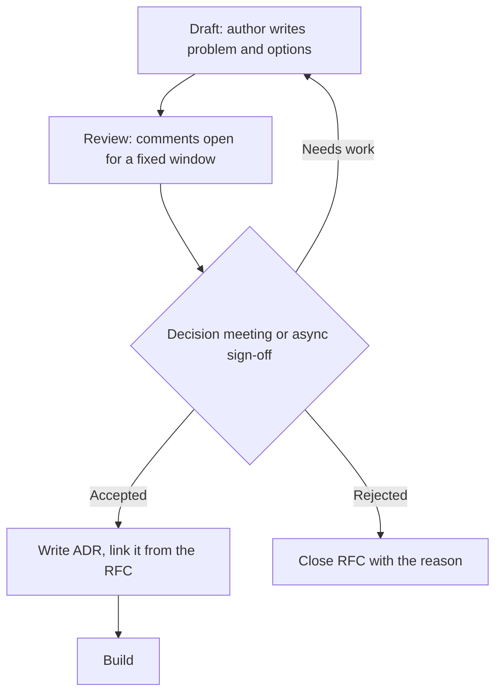

# RFCs and ADRs: how technical decisions get made

An **RFC** (request for comments) is a proposal written before the work, to get the design right and to get the people affected to agree. An **ADR** (architecture decision record) is the short, permanent record of what was decided and why. An RFC is a conversation; an ADR is the minutes. Most RFCs end in one ADR.

## When you need which

| Change | What to write |
|---|---|
| Reversible in a day, inside one team's code | Nothing extra. A clear PR description is enough |
| Hard to reverse, but only one team is affected (a library, a table design) | An [ADR](../adr/0000-template.md) in the team's repository |
| Crosses team or service boundaries, changes a public API or a shared schema, adds a new runtime, datastore or vendor, or costs more than [an agreed amount] a year | An [RFC](0000-template.md), then an ADR for the outcome |
| Affects how every team works (a CI gate, an on-call rule, a language standard) | An RFC reviewed by the engineering leads group, then an ADR |

If you are unsure, write the one-paragraph problem statement and ask. That paragraph is the start of the RFC anyway.

## Lifecycle

1. **Draft.** The author fills in the [template](0000-template.md). Problem and options come before the proposal. Open it as a PR so comments sit next to the text.
2. **Review window.** Announce it in the engineering channel with a closing date: 5 working days by default, 10 for cross-org changes. Name the required reviewers: one from each affected team plus one person who is likely to disagree.
3. **Decide.** The decider named in the RFC decides by the closing date, in a short meeting or in writing. Consensus is welcome but not required. Silence from a required reviewer after the window counts as no objection.
4. **Record.** Merge the RFC with its final status. Write the ADR, which links back to the RFC. The ADR is what people read in a year; the RFC is the background.
5. **Revisit only with new facts.** Reopening an accepted decision needs a new RFC that names what changed. That keeps decisions from being relitigated by whoever was absent.

## Rules that keep this light

- **Short.** Two to four pages. If it is longer, the problem is not clear yet or it is several RFCs.
- **Options, including "do nothing".** An RFC with one option is an announcement.
- **One decider.** Name the person who makes the call if reviewers disagree. Usually the most senior engineer or manager who owns the outcome.
- **Time-boxed.** A review window that never closes is a veto by delay.
- **Prototype where it settles an argument.** Half a day of code beats a week of comments about performance.

## Where they live

- RFCs: `docs/rfc/NNNN-short-title.md` in the repository most affected, or in a central `rfcs` repository for org-wide changes.
- ADRs: `docs/adr/NNNN-short-title.md` next to the code they describe. See the [template](../adr/0000-template.md) and an [example](../adr/0001-reusable-ci-quality-gate.md).
- Number them in order and never reuse a number. Superseded records stay, marked as superseded, so the history reads in one place.

## Signs it is working

- Decisions that cross teams have a written record you can link to.
- Review windows close on time, and most RFCs are decided within two weeks of opening.
- New joiners read ADRs to learn why the system looks the way it does.
